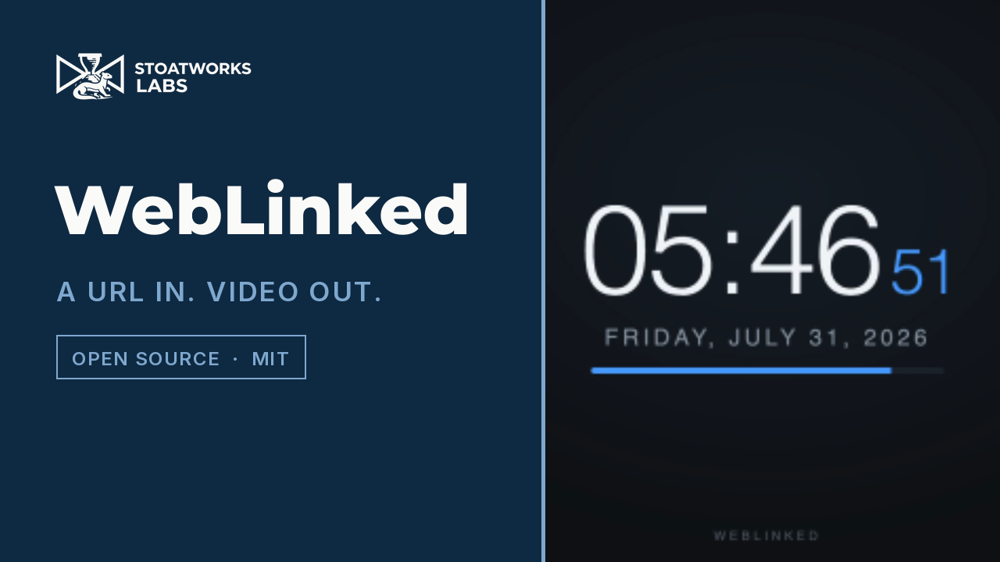
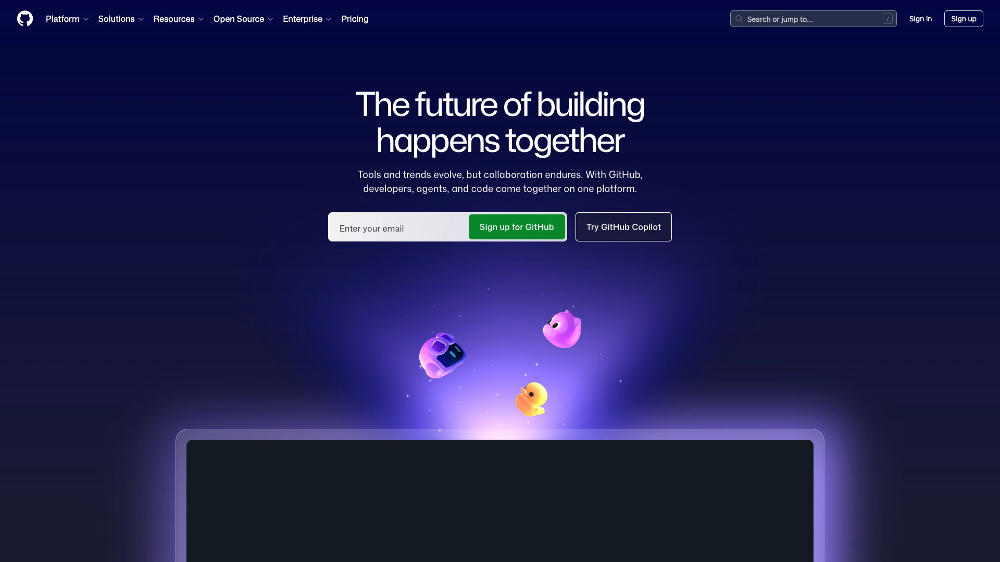

# WebLinked

> **AI-assisted project.** This codebase was created with [Claude](https://claude.com/claude-code)
> (Anthropic), directed and reviewed by a human author. NDI works end to end, alpha included,
> DeckLink has been checked on a real Duo 2 with the colour confirmed by an SDI loopback
> capture, and Syphon against Resolume Arena. **OMT and AJA have never been tested against a
> receiver or a card.** It runs on all three platforms: Windows x86_64 and Linux were tried on
> real systems in August 2026, NDI included, on both. **I've only verified frame rates on macOS
> and Linux**, because the Windows machine I test on is a two-vCPU VM with no GPU, so nothing
> here claims a rate for a real Windows PC. [Status, honestly](#status-honestly) says which is
> which, and [docs/04-verification.md](docs/04-verification.md) records what was measured and
> how.

**A URL in. SDI and video-over-IP out.**

WebLinked renders a web page offscreen at a broadcast raster and frame rate, then sends it to
Blackmagic DeckLink and AJA cards over SDI, to the network as [NDI](https://ndi.video) and
[OMT](https://openmediatransport.org), and fullscreen to a GPU-attached display. Point it at a
scoreboard, a lower-third, a countdown clock, a dashboard or a whole HTML playback page, and
it becomes a source your vision mixer can cut to, or a feed for a projector or LED processor.

It's small on purpose. There's one binary and no service to install, and the browser end has
no framework in it. You drive it from a control page, over HTTP, or over OSC from Companion
or a show-control system.

```bash
weblinked --url https://example.com/scoreboard --format 1080p50 --ndi=Scoreboard

# A keyed graphic: alpha over NDI, and key + fill out of a DeckLink
weblinked --url https://example.com/lower-third --alpha --ndi=LowerThird --key --decklink=0

# Fullscreen on the second display, alongside SDI
weblinked --url https://example.com/wall --screen=1 --decklink=0

# An overlay for Resolume, with the page's alpha intact (macOS)
weblinked --url https://example.com/lower-third --syphon=LowerThird

# Several at once, each with its own browser, clock, raster and outputs
weblinked --config show.json
```

---

[](https://www.youtube.com/watch?v=O5Z4SFGD3bA)

*A 75-second tour of the app, driven over its own HTTP control API. A separate receiver
(`tools/ndi_probe`) picks up the NDI, and the SDI output is a real DeckLink Duo 2: the panel
names the sub-device it opened, and both outputs run off the same clock.
[docs/04-verification.md](docs/04-verification.md) says what's verified and what isn't.*


*The control page, driving two sources. That's the whole UI: WebLinked serves it over HTTP and
any browser on the network can reach it. The strip along the top has a live thumbnail per
source and only appears when there's more than one, so a single-source launch looks the same
as it always did. The preview comes off the same frame pipeline as the SDI and NDI outputs, so
if the preview's right, the outputs are right.*

| Settings | Diagnostics |
|---|---|
| [](docs/images/settings-page.png) | [](docs/images/diagnostics-page.png) |
| Outputs, with only the fields each backend has. Saved to a file the next launch reads back. | The live log at a level you can change while the fault is happening, and a bundle that downloads. |

Both images below are real 1920×1080 frames, received over NDI by a separate receiver
(`tools/ndi_probe`) and converted back to RGB, not screenshots of a browser. They're what a
vision mixer would have seen.

| A live page | A time-of-day clock |
|---|---|
|  |  |
| source `site` | source `clock` |

Both were on the network **at the same time**, from the one process that served the control
page above. They're the two chips in its strip.

`tools/clock.html` comes with the repo, and it's a handy thing to point at a feed. A clock is
the quickest way to see whether a signal's live, and its sub-second progress bar makes dropped
frames visible to the naked eye.

Regenerate all five with [`tools/screenshots.sh`](tools/screenshots.sh).

---

<!-- downloads:start -->

## Download

**[v1.3.0](https://github.com/stoatworks-labs/weblinked/releases/tag/v1.3.0)** — prebuilt for macOS, Windows and Linux. Pick your platform:

<details>
<summary><b>macOS</b> — Apple Silicon</summary>

| Build | Download | Size |
| --- | --- | --- |
| Apple Silicon · .dmg disk image | [`weblinked-engine-1.3.0-macos-arm64.dmg`](https://github.com/stoatworks-labs/weblinked/releases/download/v1.3.0/weblinked-engine-1.3.0-macos-arm64.dmg) | 141 MB |
| Apple Silicon · .pkg installer | [`weblinked-engine-1.3.0-macos-arm64.pkg`](https://github.com/stoatworks-labs/weblinked/releases/download/v1.3.0/weblinked-engine-1.3.0-macos-arm64.pkg) | 141 MB |

</details>

<details>
<summary><b>Windows</b> — x64</summary>

| Build | Download | Size |
| --- | --- | --- |
| x64 · .exe installer | [`weblinked-engine-1.3.0-windows-x86_64-setup.exe`](https://github.com/stoatworks-labs/weblinked/releases/download/v1.3.0/weblinked-engine-1.3.0-windows-x86_64-setup.exe) | 135 MB |
| x64 · .zip archive | [`weblinked-engine-1.3.0-windows-x86_64.zip`](https://github.com/stoatworks-labs/weblinked/releases/download/v1.3.0/weblinked-engine-1.3.0-windows-x86_64.zip) | 182 MB |

</details>

<details>
<summary><b>Linux</b> — x64</summary>

| Build | Download | Size |
| --- | --- | --- |
| x64 · .tar.gz archive | [`weblinked-engine-1.3.0-linux-x86_64.tar.gz`](https://github.com/stoatworks-labs/weblinked/releases/download/v1.3.0/weblinked-engine-1.3.0-linux-x86_64.tar.gz) | 357 MB |

</details>

All builds, checksums and release notes: [github.com/stoatworks-labs/weblinked/releases](https://github.com/stoatworks-labs/weblinked/releases).

macOS builds are signed and notarised and open normally. The Windows builds are unsigned, so SmartScreen warns once.

<!-- downloads:end -->

## What it does

- **Renders any URL** through Chromium (CEF), offscreen, at the exact raster and rate you ask
  for: 1080p50, 720p59.94, 1080i25, 2160p30, or something odd like `3840x600p60` for an LED
  strip.
- **Carries the page's audio** (WebAudio, `<video>`, anything Chromium plays) as 48 kHz float,
  embedded in SDI or sent alongside the IP video.
- **Outputs to seven kinds of destination at once**: DeckLink, AJA, NDI, OMT, a fullscreen GPU
  display, a Syphon source other applications on the same machine can pick up, and RTMP/SRT to
  a streaming server. Every output takes the same frame, so what NDI sees is what SDI sees.
- **Straight into a VJ application** (`--syphon` on macOS, `--spout` on Windows). The page
  turns up as a source in Resolume Arena, VDMX, TouchDesigner or anything else that speaks
  either protocol, on the same machine, over shared memory, with the page's own alpha intact so
  an HTML overlay lands on a layer already keyed. Verified against Arena 7.27.1, which works out
  it's premultiplied without being told. The Spout backend is only verified against its own
  receiver, not against a real Spout application.
- **Fullscreen on a display** (`--screen`), for a projector, a confidence monitor or an LED
  processor fed from a GPU head. It doesn't open a second browser window. It puts the frames
  the engine has already made straight onto the glass with Metal (Direct3D on Windows, EGL on
  Linux), which is why it stays consistent with the SDI and NDI outputs. It's paced by the
  *display*, so a 50 Hz page on a 60 Hz monitor repeats frames instead of tearing, and it fits,
  fills or stretches to a head whose shape doesn't match the raster.
- **Straight to a Linux display** (`--kms`), with no X server, no compositor and no GPU: it
  uses the kernel's own display interface, and the CPU does the drawing. That's for small
  boards driving a screen and nothing else. `--rotate` turns the picture for a screen hung on
  its side, and a page that isn't changing costs almost nothing.
- **Frame-accurate pacing.** The engine's clock drives Chromium one frame at a time
  (`SendExternalBeginFrame`) rather than letting the browser paint on its own timer, so 50
  ticks a second means 50 paints a second.
- **Alpha, done properly.** NDI and OMT carry the page's transparency, and a DeckLink can
  output **key + fill** on separate SDI connectors (or key internally over its own input).
  Chromium composites premultiplied and most destinations here expect straight alpha, so
  WebLinked un-premultiplies. Without that, soft edges, drop shadows and fades all come out too
  dark on a keyer. A keyer set to premultiplied key (an ATEM DSK with Pre Multiplied Key on)
  wants the opposite, and `--key-premultiplied` beside `--key` sends it the fill as Chromium
  painted it. Measured on the wire so far: the alpha and the colour under it over NDI, and
  the fill of an SDI key + fill. The SDI key channel itself hasn't been, and OMT has never met
  a receiver.
- **A background colour, per output.** The same page can leave twice: as a key down an SDI
  keyer or an NDI feed with alpha, and composited over flat green for a switcher that only has
  a chroma keyer. You set the colour per output and toggle it against transparent from the
  settings page, so one browser paint feeds both. Changing it doesn't restart the output.
- **An interactive preview.** The control page's preview passes clicks, scrolling and typing
  to the live page, which is the only practical way to get rid of a cookie banner, close a
  modal or sign in on a machine whose browser you can't otherwise reach. It's **on by default**
  (`--no-interactive` turns it off), and always outlined when armed, because it's the on-air
  output. A link that asks for a new tab loads in place rather than opening a window, since a
  browser with no windows can't own one.
- **A settings page.** Add, edit, remove, start and stop outputs from the browser, with only
  the fields each backend actually has, change raster, colour matrix and pacing, and save the
  lot to a file the next launch reads back. Anything given on the command line still wins over
  the file.
- **Diagnostics in the app.** The live log, with a level you can change while the fault is
  happening, a crash report on demand, and a one-file diagnostics bundle that **downloads**
  rather than naming a path on a machine you're not sitting at.
- **Live control**: change the URL, reload, run JavaScript in the page, change raster, or stop
  and start an output mid-show, from the control page, HTTP, or OSC.
- **Several sources in one process, as tabs.** Each is an independent pipeline with its own
  browser, clock, raster and outputs, and they share nothing but Chromium's process. A page
  that hangs, a card that won't open or a raster change on one source can't touch the others.
  Add one with `+ tab` on the control page, or start a whole show at once with
  `--config show.json`. Every tab routes to its own outputs, so one can be going to SDI as
  **key + fill** while another goes out over NDI. The tab bar has a live thumbnail per source.
  HTTP verbs take `?source=<id>` and OSC takes `/weblinked/source/<id>/<verb>`. Leave the id
  off and the request goes to the first source, so everything that drove a single-source
  WebLinked still does.

  How many a machine can carry depends on the machine, not a setting. Three 1080p sources drop
  frames on an M4 Max; three at 720p25 don't. Measure it where the show will run.
  [docs/04-verification.md](docs/04-verification.md) has the numbers and the method.
- **A menu-bar / system-tray icon** on macOS, Windows and Linux, for a machine where WebLinked
  should live beside the clock rather than in a terminal. It shows the source count, opens the
  control page, copies its address and quits cleanly. `--no-tray` turns it off.

## What it does not do

- No compositing, layers or playlist. Each source renders one page. If you need two graphics
  in one picture, that's what the page is for, and if you need two pictures, that's what a
  second source is for.
- No capture or input. Output only.
- No genlock. The engine's clock is a software clock, and an SDI card's own scheduled playback
  absorbs the difference. See [docs/01-architecture.md](docs/01-architecture.md) for where that
  boundary sits and what it costs.

---

## Status, honestly

| Backend | State |
|---|---|
| **NDI** | **Verified end to end**, including alpha. A real receiver confirms raster, rate, pixel format, colour and audio. |
| **Preview** | Verified, and interactive — it is the control page's confidence monitor. |
| **Several sources** | **Verified**: three at once on three rasters, each confirmed by a separate receiver, with one retargeted and a fourth added and removed mid-run without disturbing the others. Frame rates are a capacity question — see below. |
| **Settings + diagnostics pages** | Verified against a running instance: outputs added, renamed and removed, settings saved and read back after a restart, the log and bundle served. |
| **Screen (fullscreen GPU)** | **Verified on this Mac, across two displays**: picture, all three scaling modes, live add and remove, and pacing measured against the display's own refresh — a 50 Hz source on a 60 Hz head presents at 60.1/s, a ratio of 1.199 against a theoretical 1.200. No projector. **Linux verified too**: a 1920x1080 window under X11/EGL on software GL, checked by screenshotting it against the source page rather than by reading counters. **Windows verified on a software renderer only**: on first contact it showed nothing but black while its counters reported frames presented; v1.0.5 fixed that, checked by reading the desktop back (`tools/screen_probe_win.cpp`) on the lab VM's Microsoft Basic Render Driver. **No real Windows GPU has run the fixed code.** |
| **KMS (Linux, no X)** | **Verified on a virtual display, not a real one**: all four rotations and letterboxing, read back from the scanout by ffmpeg's `kmsgrab`, running inside the BirdDog PLAY's own Debian 10 rootfs. No real display controller or monitor yet, and no measurement of the copy's cost on a slow CPU. |
| **Menu bar / tray icon** | **Verified on all three platforms, by using it.** macOS: icon photographed, menu opened, clean shutdown. Windows x86_64: icon confirmed present-then-absent by pixel diff, menu opened, *Copy control address* checked against the clipboard, Quit shut down in order. Linux: registered with KDE Plasma's own StatusNotifierWatcher, menu read over dbusmenu, Quit clean. **Not verified:** the icon's pixels on a healthy KDE desktop, and the Explorer-restart re-add path on Windows. |
| **OMT** | Compiles against `libomt.h` 1.0.0.16. **Never tested against an OMT receiver.** |
| **DeckLink** | **Verified against a real card, on two card profiles** (DeckLink Duo 2): output, pre-roll and buffer level, with colour confirmed by SDI loopback captures at 1080p50 and 1080p25 — identical sampled values in a full-duplex and a half-duplex profile. Key + fill is measured to the extent one card allows: the fill carries straight alpha. The **key channel itself**, the internal-keying composite and **audio over SDI** are still unmeasured, and a keyed 1080p50 is beyond what this card will carry. **On someone else's card:** the frame ring (in WebLinked's own memory on SDK 14.3 and later) and the catch-up after a stall, new in v1.3.0, ran here only against a simulated card (`tools/dl_fake_card.cpp`). Daniel Nyström then ran them on the UltraStudio Mini Replay 12G that found the bugs (Desktop Video 16.4, 1080p25 keyed into an ATEM): eight hours with 42 injected faults and no hang, where the old build hung four times in 15 hours. I haven't run them on a card myself; section 40 of the verification doc has Daniel's figures. |
| **AJA** | Compiles against libajantv2 18.1. **Never run against a card.** Off by default. |
| **Container image** | Builds from this repository, runs the unit suite as a build step, and is smoke-tested headless in CI on every build before it is pushed: running, ticking, painting, the right version, a correctly sized preview frame. **No NDI receiver has seen output from the image**, because libndi is not in it. See [docker/README.md](docker/README.md). |
| **Shared surface (Syphon / Spout)** | **Syphon verified against Resolume Arena 7.27.1**: it lists the source, loads it on a layer at 1920x1080 and labels it premultiplied unaided. Colour, alpha and orientation are exact through a receiver linking *Arena's own* Syphon framework. **Spout is verified only through a harness** — the real backend and SDK, its pixels checked by a Spout receiver, but no real Spout application was involved and the shipped Windows binary's own `--spout` output has not been driven. |

Read [docs/04-verification.md](docs/04-verification.md) before you trust any of this on air.
It records what was measured, how, and what wasn't.

Verified on macOS 26.4 / Apple Silicon, and since August 2026 on Windows 11 x86_64 and Ubuntu
24.04 as well. On both of those the unit suite passes (115 tests, 26191 checks), the control
API, OSC, mDNS and the tray work, and an independent receiver on another machine received and
decoded the NDI. Two things that run there are still unproven: DeckLink and AJA (neither
machine has a card), and **Windows frame-rate performance**, because that machine has two
vCPUs and no GPU driver. Since v1.1.0 it publishes about 50 frames/s at 1080p50 (50.2/s over
three one-minute runs, no held frames), but no Windows PC with a GPU has been measured. See
[docs/02-building.md](docs/02-building.md) and §32–34 of
[docs/04-verification.md](docs/04-verification.md).

---

## Quick start

```bash
git clone https://github.com/stoatworks-labs/weblinked
cd weblinked
cmake -S . -B build -G Ninja -DCMAKE_BUILD_TYPE=Release
cmake --build build
```

CMake downloads the CEF binary distribution the first time you configure (~125 MB) and caches
it in `third_party/cef`. You don't need anything else to build: the NDI and OMT backends find
their libraries at run time, and the SDI SDKs are optional.

Then:

```bash
./build/Release/WebLinked.app/Contents/MacOS/WebLinked \
  --url https://example.com/graphic.html \
  --format 1080p50 \
  --ndi=Graphic
```

WebLinked doesn't open a window of its own. It's a render host and a control server, and the
UI is the control page it serves. You open that in a browser, drive it over HTTP or OSC, or
reach it from its own menu-bar / system-tray icon, which opens the page for you and quits the
process cleanly. That icon is a platform status item rather than a window, which is why
there's still no GUI toolkit anywhere in this project.

Start it with no arguments (by a double-click, say) and it hands the control page to your
default browser once the server's listening, so it doesn't look as if nothing happened. A
command line is assumed to know what it wants and gets no browser unless you add `--open`.
`--no-open` stops it either way.

`--help` lists every option and reports which backends this build contains.

**One download.** Up to v0.7.1 there were two: a *desktop app* that wrapped the engine in a
separate tray launcher, and the *engine only*. The engine puts its own icon in the menu bar
now, so the wrapper was retired in v1.0.0 and there's just the one thing to install.

## Run it in Docker

For a server with no display and no card: a URL in, NDI out, headless.

```bash
docker run -d --name weblinked --network host \
  -v /path/to/ndi/lib:/opt/ndi/lib:ro \
  -e WEBLINKED_BIND=100.64.0.5 -e WEBLINKED_TOKEN=change-me \
  ghcr.io/stoatworks-labs/weblinked:edge \
  --url 'https://grafana.example/public-dashboards/abc123' \
  --format 1080p50 --ndi=Grafana
```

- **`ghcr.io/stoatworks-labs/weblinked`**: `:edge` follows `main`, `:X.Y.Z` is a release, and
  `:sha-xxxxxxx` is one commit. It used to be published as
  `ghcr.io/stoatworks-labs/weblinked-docker`, which doesn't update any more: its `:edge` is
  stuck at a build of WebLinked from 22 August 2026 (just after v1.0.1). Move to the new name.
- **Bring your own NDI runtime.** `libndi.so.6` isn't in the image and can't be, so mount it at
  `/opt/ndi/lib`. Without it everything runs and the NDI output reports itself unavailable.
- **Host networking is required** for NDI discovery, and puts the control port on every
  interface the server has. Keep it on a tailnet, bind it there, and set a token:
  `POST /api/script` runs arbitrary JavaScript in the page.
- NDI, OMT, the preview and HTTP/OSC control only. No SDI, screen, KMS, Syphon, Spout or
  RTMP/SRT output, and no mDNS advertisement, so find it by address.

Everything else (the environment variables, Compose, Grafana, building the image yourself and
what's verified) is in [docker/README.md](docker/README.md).

## Control

The control page is served at `http://127.0.0.1:7654/`, so a phone on the same
network is a remote panel.

### It finds itself

Start it with `--bind 0.0.0.0` and WebLinked advertises its control API over mDNS as
`_weblinked._tcp`, so [rookery](https://github.com/stoatworks-labs/rookery), the Companion
module and anything else can list it instead of asking you for an address.
`--name "Stage Left"` sets what shows up. Without it, the name is the host and the control
port.

The advertisement carries the **OSC port and prefix**, which nothing in the HTTP API reports.
A controller that has to guess them looks perfectly connected and silently drops every cue,
because OSC never replies to anything.

An instance on the default loopback bind **doesn't advertise, on purpose**: nothing off its
machine could reach the address it would publish. `--no-mdns` turns it off entirely, for
networks where multicast is filtered.

```bash
# What is on the network right now
dns-sd -B _weblinked._tcp          # macOS
avahi-browse -r _weblinked._tcp    # Linux
```

```bash
curl -X POST -d '{"url":"https://example.com/next"}' http://127.0.0.1:7654/api/url
curl -X POST -d '{"ignore_cache":true}'              http://127.0.0.1:7654/api/reload
curl -X POST -d '{"name":"Graphic","enabled":false}' http://127.0.0.1:7654/api/output
# Click at the centre of the page, in normalised coordinates
curl -X POST -d '{"type":"down","nx":0.5,"ny":0.5}'  http://127.0.0.1:7654/api/input

# With several sources, ?source= picks one; without it you get the first
curl http://127.0.0.1:7654/api/sources
curl -X POST -d '{"url":"https://example.com/next"}' \
     'http://127.0.0.1:7654/api/url?source=lower-third'
```

Over OSC, on port 7655 (this is the shape a Companion button sends):

```
/weblinked/url          "https://example.com/next"
/weblinked/reload       1
/weblinked/output/Graphic  0
/weblinked/script       "showLowerThird('Anna Kowalski')"

# One feed by name, when several are running
/weblinked/source/lower-third/url  "https://example.com/next"
```

`/weblinked/script` is the useful one: a graphic that already exposes a function can be driven
without any integration work at all.

The full reference is [docs/03-control-api.md](docs/03-control-api.md).

**The control surface has no authentication by default** and binds to loopback. If you bind it
to a network interface, set `--token`, and bear in mind that anyone who can reach the port can
change what's on air.

## Requirements

- **NDI**: nothing extra with a download, which carries the NDI runtime inside it. A build
  from source loads an installed NDI runtime or SDK at run time. Without one the NDI output
  reports itself unavailable and everything else keeps working.
- **OMT**: `libomt` and `libvmx` beside the binary, from the
  [OMT releases](https://github.com/openmediatransport/libomtnet/releases).
  Published for Windows x64/arm64 and macOS arm64 only. There's no Linux binary.
- **DeckLink**: Desktop Video installed, plus the DeckLink SDK at build time
  (`-DDECKLINK_SDK_DIR=...`). SDK 14.3 and later work as well as the older ones (14.3 moved
  where a frame's pixels live, and the backend handles both); it's built against 12.0 and 16.0.
- **AJA**: [libajantv2](https://github.com/aja-video/libajantv2) 18.x at build
  time (`-DNTV2_DIR=... -DNTV2_BUILD_DIR=...`) and `-DWEBLINKED_WITH_AJA=ON`.

## Documentation

- [docs/00-overview.md](docs/00-overview.md): what this is and who it's for
- [docs/01-architecture.md](docs/01-architecture.md): the pipeline, and the decisions that
  shaped it
- [docs/02-building.md](docs/02-building.md): building on each platform, and the macOS bundle
  traps
- [docs/03-control-api.md](docs/03-control-api.md): HTTP and OSC reference
- [docs/04-verification.md](docs/04-verification.md): what has actually been proven, and how
  to reproduce it
- [docs/diagnostics.md](docs/diagnostics.md): logs, crash reports, bundles
- [docs/05-settings.md](docs/05-settings.md): the settings page and the file it writes
- [docs/06-ndi-distribution.md](docs/06-ndi-distribution.md): why NDI is loaded at run time,
  what the licence permits, and the attribution every project owes
- [docker/README.md](docker/README.md): the headless container image, with NDI out and no
  display or card
- [AGENTS.md](AGENTS.md): orientation for an AI assistant or a new contributor

## Control it from Companion

[**companion-module-weblinked**](https://github.com/stoatworks-labs/companion-module-weblinked) is a [Bitfocus Companion](https://bitfocus.io/companion) connection module for this app.

It can navigate, reload, **run JavaScript in the page**, mute, change format, and switch any
output on or off, and it shows the pacing and receiver numbers that tell you whether the
graphic is actually going out.

It uses the HTTP API rather than OSC, because OSC here has no feedback path: a button could do
things but never light up. If you only need to fire buttons, the generic OSC module works fine
(see [docs/03-control-api.md](docs/03-control-api.md)).

It's not in the official Companion module store, so install it via
**Settings → Developer modules path**.

<!-- attributions:start -->
This project is built on other people's work — see [ATTRIBUTIONS.md](ATTRIBUTIONS.md).
<!-- attributions:end -->

## Licence

MIT, see [LICENSE](LICENSE).

Third-party components keep their own licences. `third_party/omt/libomt.h` is MIT
(Open Media Transport contributors). The CEF binary distribution, the NDI SDK,
the DeckLink SDK and libajantv2 are each obtained separately under their own
terms; none of them are redistributed here.

**NDI® is a registered trademark of Vizrt NDI AB.** See <https://ndi.video>. The
NDI runtime isn't in this repository: the code loads it at run time, and the
release downloads carry a copy. See
[docs/06-ndi-distribution.md](docs/06-ndi-distribution.md) for why, and for what
the licence does and does not permit. NDI Tools are not redistributed either;
get them from <https://ndi.video/tools>.

This project is not affiliated with or endorsed by Vizrt, Blackmagic Design, or
AJA Video Systems.

---

*Check it over before you trust it with a show. [Status, honestly](#status-honestly) lists
what has and hasn't been measured.*
