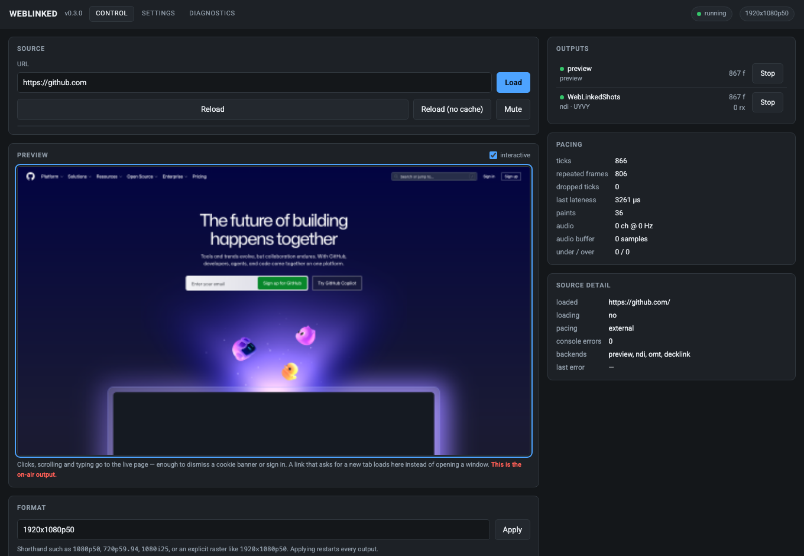
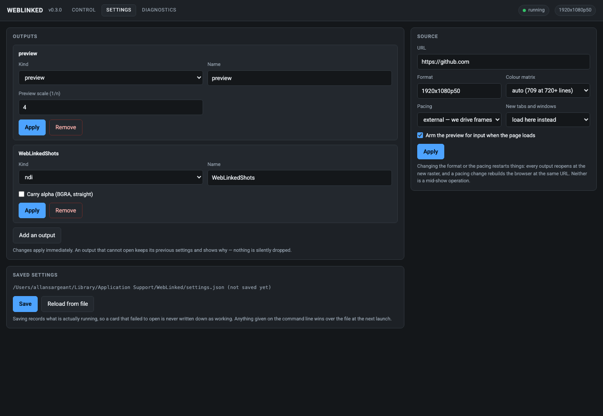
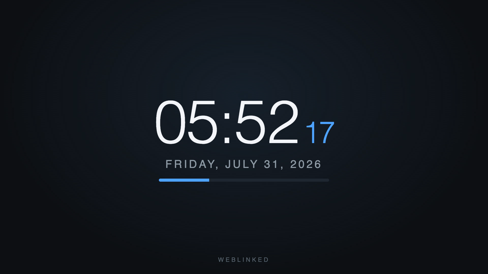
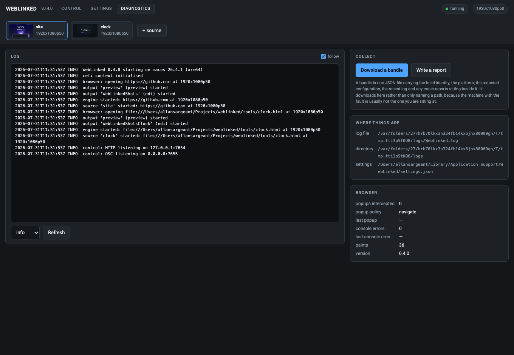

# WebLinked user guide

WebLinked is one binary that turns a web page into a proper video output at the raster and
rate you specify: SDI on a DeckLink or AJA card, NDI and OMT on the network, and a fullscreen
GPU window, all from the same pipeline at the same time.

It's for someone who already knows what 1080p50 means and has a vision mixer to plug into, so
it doesn't try to hide the broadcast decisions from you.

> **What's proven, and what isn't.** I've run WebLinked on a live event, though nothing was
> measured there. NDI is verified end to end against a real receiver, alpha included. SDI is
> measured against a real DeckLink Duo 2, with colour confirmed by loopback capture against an
> independent BT.709 reference.
>
> Not everything, though. **The SDI key channel itself, audio over SDI and genlock over hours
> are unmeasured**, and **AJA and OMT compile against their SDKs but have never met hardware or
> a receiver**. The fullscreen output's Linux backend has now been run and renders correctly.
> Its Windows backend showed nothing but black until v1.0.5, and **is verified on a software
> renderer but not yet on a real GPU**. Windows and Linux themselves aren't just signed off on
> a compile any more: both were run on real systems in August 2026, NDI included. But
> **frame-rate performance is verified on macOS and Linux only**, because that Windows machine
> can't sustain a rate. [04-verification.md](04-verification.md) gives the numbers and the
> method rather than a promise.
>
> One more, newer than the rest. I wrote the DeckLink fixes in v1.3.0 (frames made once and
> reused, and catching up after a stall) with no card plugged in, and ran them against a
> simulated one. Daniel Nyström, who found the bugs, then ran them on the rig they were found
> on: eight hours into an ATEM with 42 faults thrown at it, and no hang. **I still haven't run
> them on a card myself**, so section 40 of the verification doc gives Daniel's figures as
> Daniel's.

---

## What it is not

- **Not a media server.** No playlist, layers, compositing or transitions. It renders one
  page, and two graphics at once is a job for the page.
- **Not a capture tool.** Output only.
- **Not genlocked.** The engine's clock is a software clock, and an SDI card's scheduled
  playback absorbs the difference. [01-architecture.md](01-architecture.md) says which number
  in `/api/state` tells you it's going wrong.
- **Not a replacement for CasparCG** if you already run CasparCG.

---

## Running it

WebLinked **has no window of its own.** It's a render host and a control server, and the
control page it serves is the whole UI. Open it in any browser, or click the WebLinked icon in
your menu bar (macOS) or notification area (Windows and Linux) and choose **Open control page**.

Double-click it and it opens the control page in your default browser once the server's up,
because a launch with no arguments at all is taken as "show me something". Type a command line
and it stays quiet, because you asked for something specific. `--open` and `--no-open` settle
it either way.

There's **one download** per platform. Earlier versions had a second, a *desktop app* that
wrapped the engine in a separate tray launcher. The engine puts its own icon in the menu bar or
notification area now, so that wrapper was retired in v1.0.0.

```bash
WebLinked --url https://example.com --format 1080p50 --ndi=Test --headless
```

Then open **<http://127.0.0.1:7654/>**. `--help` lists every flag *and which backends this build
actually contains*, which is the quickest way to find out whether your download has SDI in it.

> **Downloads bundle the NDI runtime**, so NDI works on a machine that never installed the SDK.
> **The hosted builders have no DeckLink or AJA SDK**, so **SDI output needs a local build**
> (see [02-building.md](02-building.md)). Any DeckLink SDK from 12 on will do, current ones
> included: 14.3 moved where a frame's pixels live, and the build copes with either.

### On a server, in Docker

For a headless box with no display and no card there's a container image,
**`ghcr.io/stoatworks-labs/weblinked`** (`:edge` follows `main`; it used to be published as
`weblinked-docker`). It's NDI out and the control API and nothing else, and **unlike the
downloads it carries no NDI runtime**. You mount `libndi.so.6` into it yourself, because a
public image has no EULA to carry the NDI licence's terms. It needs host networking for NDI
discovery, which puts the control port on every interface, so keep it on a tailnet and set a
token. See [docker/README.md](../docker/README.md).

---

## The control page



*The preview is an output in its own right, fed by the same pipeline as everything else, so
**if the preview's right, the outputs are right**. The red note under it spells it out: this is
the on-air output.*

**The preview is interactive.** Clicks, scrolling and typing go to the live page, which is
enough to get rid of a cookie banner or sign in. A link that asks for a new tab loads *here* rather than
opening a window.

**Several sources run as tabs.** Each is a whole pipeline with its own browser, clock, raster and
outputs, so one hung page can't touch the others.

### The pacing panel is the health readout

| Field | What it tells you |
|---|---|
| **ticks** | Frames the clock has asked for |
| **repeated frames** | The page didn't paint in time, so the last frame went out again |
| **dropped ticks** | The pipeline missed a frame slot entirely — the number to watch |
| **last lateness** | How late the most recent frame was |
| **paints** | How often the page actually rendered |
| **under / over** | Audio buffer starvation and overflow |

A page that only repaints when its data changes will show a high repeated-frame count and be
perfectly healthy. **Dropped ticks are the ones that mean something's wrong.**

---

## Outputs



Each output editor shows **only the fields that backend has**: an NDI sender gets a name and an
alpha checkbox, a DeckLink gets a device index and keying, and the preview gets a scale factor.
Offering a DeckLink keying mode on an NDI output would only invite you to set something that
then gets ignored without a word.

**Background** is on every output, because it isn't a backend setting. The engine composites
before a frame reaches a backend:

- **Transparent** keeps the page's own alpha, for a keyed SDI fill or an NDI feed with alpha.
- **A colour** composites the page over it and leaves the frame fully opaque, for a switcher that
  only has a chroma keyer.

Changing it doesn't restart the output.

> **Apply replaces an output in place** rather than removing and re-adding it. If the new
> settings can't open (a card already claimed, an NDI name in use), **the previous output is
> restarted** and the reason is shown. Renaming an output can't leave you with no output.

### Keying a DeckLink

`--key` (or **Mode: Key + fill** in the editor) puts fill and key on separate SDI connectors;
`--key=internal` (**Overlay**) has the card key over its own input instead. `--key-level`
sets the keyer's overall opacity.

The fill goes out with **straight** alpha unless you say otherwise, because most keyers want
it that way. A keyer set to premultiplied key (an ATEM DSK with **Pre Multiplied Key** on,
for one) wants the fill as Chromium painted it, and given a straight one it lays the whole
fill colour over every soft edge, so fades and drop shadows come out too bright. For that
keyer add `--key-premultiplied` beside `--key`, before the `--decklink` it's for, or tick
**Premultiplied fill** in the editor:

```bash
WebLinked --url https://example.com/lower-third --key --key-premultiplied --decklink=0
```

Match the keyer and the fill and leave it there. Getting it wrong either way is visible only on
partial alpha, which is where nobody looks during a line-up. Daniel Nyström, who wrote
this option, measured both on his rig: details in the changelog.



---

## Settings, and what wins

```
macOS    ~/Library/Application Support/WebLinked/settings.json
Windows  %APPDATA%\WebLinked\settings.json
Linux    $XDG_CONFIG_HOME/WebLinked/settings.json, else ~/.config/WebLinked/
```

Override with `--settings <file>` or `$WEBLINKED_SETTINGS`; `--no-settings` ignores it entirely.
**The command line always beats the file.**

The settings file is *not* in the log directory, on purpose: logs are disposable and settings
aren't.

### Show files

**Settings → Show file** saves the running show to the computer you're sitting at and loads it
back. A show has two halves, and the two ticks choose which ones a save writes or a load recalls:

- **Tabs**: which pages are open. Loading tabs alone changes the pages and keeps every output,
  so one rig can play a different running order each session. Tabs the show doesn't have are
  closed, after a prompt, and a tab it adds starts with a preview only.
- **Outputs**: each tab's format and where it goes. Loading outputs alone restores the rig on
  the tabs already open and leaves the pages alone.

A show isn't the settings file. It lives wherever you keep it, and it carries no ports or
tokens.

---

## Control from a show

Two protocols, the same verbs: **HTTP** for the control page and scripting, and **OSC** for a
Companion button or a show-control cue. A graphic that only someone with a browser open can
change is no use once the show's running.

> **Security.** The HTTP server binds `127.0.0.1:7654` with **no authentication by default**. If
> you bind it to a network interface (`--bind 0.0.0.0`), **set `--token`**, because anyone who
> can reach the port can change what's on air. There's **no TLS**, so put it behind a reverse
> proxy or keep it on a trusted show network.
>
> **OSC has no authentication at all.** That's the protocol, not a choice I made. It listens on
> `0.0.0.0:7655`, and `--no-osc` turns it off.

Full verb list in [03-control-api.md](03-control-api.md).

---

## When something is wrong



The log lives at `~/Library/Logs/WebLinked/WebLinked.log` (or `$WEBLINKED_LOG_DIR`), and
`WEBLINKED_LOG=debug` raises the level.

> **The app's own counters only prove it *sent* something.** To check what actually arrived,
> the repo comes with two independent receivers, `tools/ndi_probe.cpp` and `tools/sdi_probe.mm`,
> each with its own BT.709 reference, so a check isn't just the code under test agreeing with
> itself.
>
> ```bash
> ./ndi_probe --source Test --frames 100 --bars
> ```

---

## Troubleshooting

| Symptom | Cause |
|---|---|
| **Control page sits on "connecting"** | The page has no build step, so one syntax error kills every line after it. If it looks dead, that is the first suspect. |
| **No SDI options anywhere** | Your build has no DeckLink/AJA SDK. `--help` lists the backends this binary contains; SDI needs a local build. |
| **High repeated-frame count** | Usually fine — the page simply isn't repainting. Watch dropped ticks instead. |
| **Dropped ticks climbing** | The pipeline is missing frame slots. Check page complexity, raster and CPU. |
| **Alpha looks wrong on SDI key/fill** | Straight alpha is measured on SDI; the key channel itself is not yet measured. Verify on your own hardware. Soft edges too *bright* usually means a keyer set to premultiplied key: add `--key-premultiplied` (see [Keying a DeckLink](#keying-a-decklink)). |
| **An output says "not answering"** | A call into that output's driver hasn't come back for over a second. The figures shown are the last it gave (`"stale": true` in `/api/state`), and changes to it are refused rather than left hanging, so the rest of WebLinked, other sources included, carries on. If it doesn't clear, restart WebLinked. |
| **A change answers "another change ... is still in progress"** | Changes to one source take turns, and this one waited 30 s behind another. Usually that's a slow card in a long settings apply; if it keeps happening, look for a "not answering" output. |
| **`/api/state` answers, but `ticks` has stopped** | The clock is stuck, usually inside an output's driver. `pacing.last_tick_age_ms` climbing past a second is the sign. A supervisor that used to wait for `/api/state` to go silent should watch that instead: it doesn't go silent any more. |
| **The control API answers 503, "too many control connections"** | Something has 64 connections open at once. Usually a client that opens a new one per poll and never closes them, or one polling an engine that isn't answering. It clears as they close. |
| **DeckLink `reanchors` went up** | The card's playhead overtook WebLinked's schedule (the process stalled for longer than the queue) and the output caught up by skipping forward. One per stall is expected; a steady climb with no stalls means the engine's clock is running slower than the card's. |
| **Output opened, then reverted to the old one** | Apply failed — a card already claimed or an NDI name in use — and the previous output was restarted. The reason is shown. |
| **A new tab opened a window instead of loading** | Shouldn't happen: no browser here owns a window, and popups are always cancelled into the same view. |
| **Colour looks off** | Check the colour matrix against the raster. Verify with `ndi_probe --bars` rather than by eye. |

---

## See also

- [00-overview.md](00-overview.md): why this exists, and what it was never meant to be
- [01-architecture.md](01-architecture.md): the pipeline, the clock, and the genlock boundary
- [02-building.md](02-building.md): building, and the optional SDKs
- [03-control-api.md](03-control-api.md): HTTP and OSC
- [04-verification.md](04-verification.md): **what has actually been measured**, with commands
- [05-settings.md](05-settings.md): every setting and what wins
- [06-ndi-distribution.md](06-ndi-distribution.md): the bundled NDI runtime
- [../docker/README.md](../docker/README.md): the headless container image
